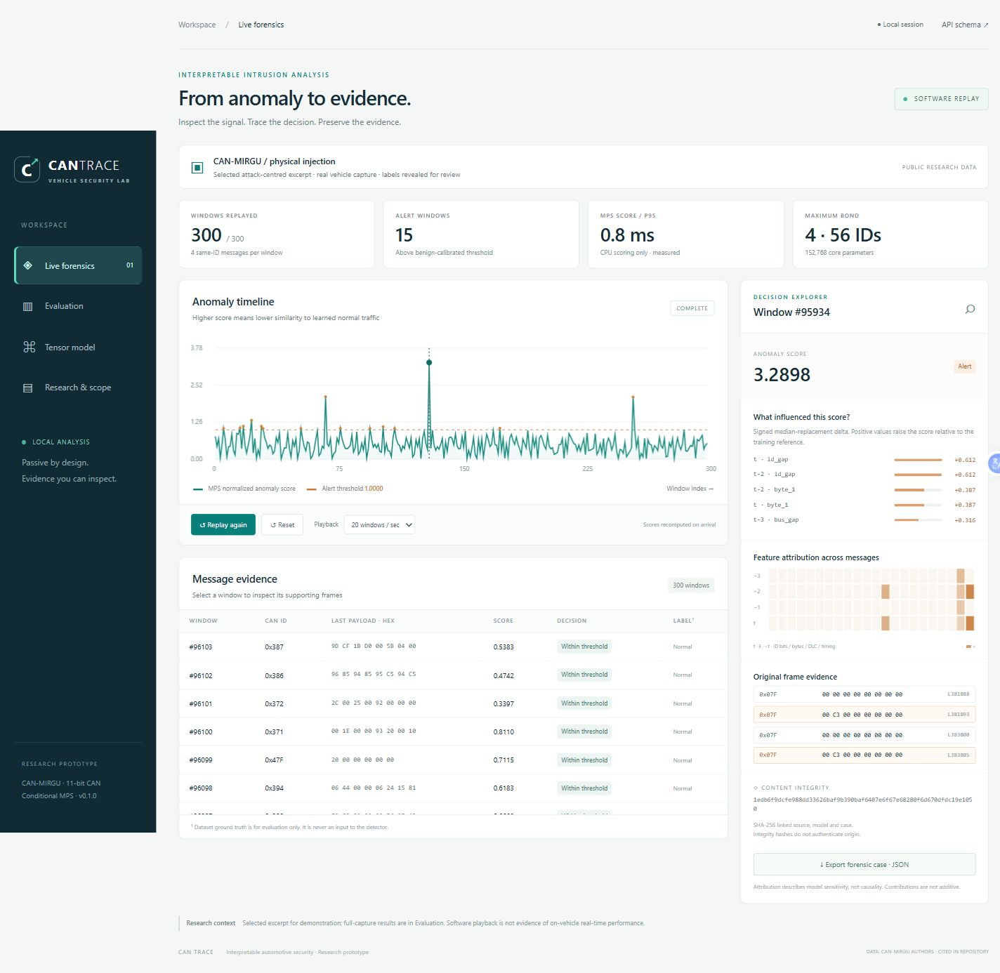
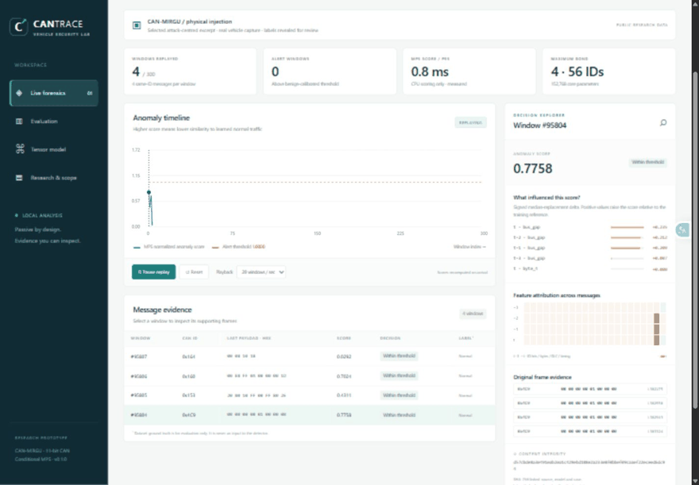
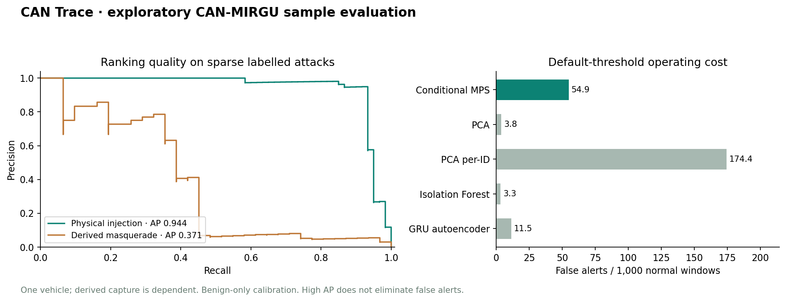

<div align="center">

# CAN TRACE

**Interpretable CAN intrusion detection. Inspectable tensor networks. Reproducible forensic evidence.**

[Quick start](#run-locally) · [Video demonstration](docs/media/can-trace-demo.mp4) · [Measured results](docs/evaluation.md) · [Research](docs/research.md) · [Recruitment handoff](docs/recruitment-handoff.md)

Python · NumPy · Matrix Product States · PyTorch · FastAPI · SocketCAN

</div>



CAN Trace is a working automotive-security research prototype that learns normal CAN traffic, scores deviations using an actual Matrix Product State (MPS), and helps an analyst inspect the messages, bytes and timing features behind an alert. It includes a local investigation UI, CPU streaming inference, public-data evaluation, four conventional/neural baselines, and content-addressed forensic JSON exports.

The implementation uses classical computation throughout. It does not require a quantum computer.

## Watch the project work

**[Play the browser demonstration — MP4](docs/media/can-trace-demo.mp4)**



The recording shows the functioning local application: replayed messages arrive, scores are recomputed, a selected alert opens feature attribution, and the evidence retains original capture line numbers. It is a software replay of an explicitly selected attack-centred excerpt, at 20 windows per second. It is not a live vehicle recording, an independent performance test, or a claim that the UI playback rate equals bus throughput. The underlying CAN-MIRGU traffic was collected by the cited dataset authors.

## What is implemented

- Strict CAN-MIRGU/candump and canonical CSV ingestion, with payload lengths, timestamps, labels, source offsets and input validation.
- Causal features: 11 arbitration-ID bits, eight payload bytes, DLC, global bus gap and same-ID gap. Four successive messages of the same ID form an 88-site tensor input.
- An ID-conditioned MPS bank built by adding product states and compressing through QR/SVD sweeps. No neural model is relabelled as a tensor network.
- Benign-only feature fitting and per-ID alert calibration; explicit unknown-ID novelty policy.
- Signed median-replacement feature sensitivity, four-message heatmaps and bond-entropy diagnostics.
- Comparisons with global PCA, per-ID PCA, Isolation Forest and a PyTorch GRU autoencoder using the same training windows and representation.
- FastAPI server-sent replay, pause/resume/reset, selectable windows, metric tables, model inspection and JSON case export.
- Passive `python-can` ingress for SocketCAN/virtual interfaces. The monitor contains no transmit operation.
- SHA-256 source/model/case references, linked event hashes and a standalone verification command.
- Controlled software fixtures for DoS, fuzzing, spoofing, replay and masquerading; these test functionality, not real-world attack-family performance.

## Measured results, including the limitations

CAN-MIRGU author-published samples: **368,296 benign frames**, **508,148 physical-injection frames**, **507,995 derived-masquerade frames**. Each attack capture contains only 118 labelled malicious frames. Window labels are positive if any of their four same-ID messages is labelled malicious. The resulting positive-window counts and prevalence differ between captures.

| Conditional MPS | Physical injection | Derived masquerade |
|---|---:|---:|
| AUROC | 0.9999 | 0.9983 |
| Average precision | 0.9437 | 0.3711 |
| Recall at default threshold | 1.0000 | 1.0000 |
| Precision at default threshold | 0.0085 | 0.0044 |
| False alerts / 1,000 normal windows | 54.8813 | 54.9171 |

**High ranking quality does not make the current operating point deployment-ready.** At the benign-calibrated default threshold, precision is low and false alerts are substantial. Per-ID PCA achieves higher average precision on these samples, and the GRU has a better default operating-point F1. The results do not establish MPS superiority or state-of-the-art detection.

The same-environment independent MPS refit produced **zero score difference across a 256-window probe**. Single-window MPS scoring measured **0.65 ms median / 0.85 ms p95** on the recorded CPU environment, excluding parsing, encoding, explanation and network. The final bank has **56 ID prototypes, maximum bond 4, and 152,768 core parameters**; the packed model is about **1.01 MiB**. These are measured prototype properties, not an ECU or full-bus latency guarantee.

The original global-window model and its weaker results are preserved in [the ablation report](docs/global_ablation.md). ID conditioning was introduced after reviewing those sample results. Final results are therefore **exploratory sample evaluation**, not untouched external validation. Thresholds still use benign data only. The masquerade sample is derived from the physical capture, so it is not independent replication. All models, confusion counts, settings and environment are in [metrics.json](artifacts/metrics.json) and [evaluation.md](docs/evaluation.md).



## Run locally

Use Python 3.11–3.13 with a CPU PyTorch wheel supported on your platform. The measured run used Python 3.13.4 on Windows. A network connection is needed once for dependencies and the pinned public samples (~65 MB). No account or API key is needed to run the project.

```powershell
git clone https://github.com/Pavan-amikula/can-trace.git
cd can-trace
python -m venv .venv
.venv\Scripts\Activate.ps1
python -m pip install -e ".[dev]"
python scripts/download_data.py
python -m cantrace.evaluate
python -m pytest -q
python -m cantrace.cli serve
```

On Linux/macOS, replace the activation command with `source .venv/bin/activate`. If PowerShell blocks activation, run `.venv\Scripts\python.exe` directly for each command; no execution-policy change is required.

Open **[http://127.0.0.1:8000](http://127.0.0.1:8000)**. Select **Start replay**, then inspect a row and export its case. **Evaluation** shows full-capture metrics rather than just the selected demo segment. **Tensor model** explains the representation and bond diagnostics. The app binds to localhost by default and uses no remote fonts or analytics.

`scripts/download_data.py` pins the authors’ Git commit and verifies expected SHA-256 digests. Raw captures and replay excerpts are excluded from Git. Re-running evaluation regenerates the local model and replay. The training/evaluation path is CPU-only and typically takes a few minutes; exact runtime depends on hardware.

For the exact package versions recorded during this run, see [requirements-tested.txt](requirements-tested.txt). `pyproject.toml` defines supported version ranges; it is not a claim of bit-identical results across all versions.

## Passive stream usage

Replay a local file through the stateful scoring path and emit alerts as JSON lines:

```bash
python -m cantrace.cli replay data/raw/injection.log > local-alerts.jsonl
```

On a Linux host where `vcan0` or a CAN interface is already configured:

```bash
python -m cantrace.cli monitor --interface socketcan --channel vcan0
```

The adapter calls `recv()` only and supports classical 11-bit CAN frames on one channel. Extended IDs, remote/error frames and CAN FD are outside this implementation. Live SocketCAN on physical hardware has **not** been validated. The automated virtual-bus test exercises the actual `python-can` receive path without vehicle hardware.

Batch evaluation uses stride 4 per ID. The monitor scores every eligible message with stride 1. This difference changes alert counts and operating characteristics; benchmark figures must not be transferred directly to live operation. Each ID needs four messages of warm-up. Initial timing gaps are zero. Missing-message detection for an ID that stops entirely would require a separate timer-driven mechanism.

## How the model works


For each normalized feature `x`, the local map is `[cos(0.9x), sin(0.9x)]`. Training sums these product states within each arbitration ID, then truncates tensor bonds using QR/SVD. Up to 48 chronologically spaced normal examples per ID are used: **2,576 windows in the recorded run**. Training order is fixed; there is no stochastic neural optimization in the MPS path.

The raw score is `-log(clip(abs(overlap), 1e-15, 1))`. Divide it by the matching ID’s benign-calibration 99th percentile (floor `1e-8`), and alert when the ratio is strictly above 1. An unseen ID receives an explicit novelty ratio of 2. This kernel-support score is **not a calibrated attack probability, a normalized Born likelihood, or a reproduction of the referenced papers’ algorithms**.

Explanations replace one feature at a time with its training median while holding the conditioning ID fixed. A positive delta means that replacement lowered the score. Deltas depend on the reference and are neither additive nor causal. Bond entropy characterizes the learned mathematical representation; it does not decode physical signals or identify an ECU.

See [architecture.md](docs/architecture.md) for split semantics, cold-start behaviour, baseline differences and evidence format.

## Verify evidence

After exporting a case in the UI:

```bash
python -m cantrace.cli verify can-trace-case-130.json
```

Cases contain original frame line numbers, source digest, model digest, encoder configuration, scores, thresholds, attribution values and a hash-linked event record. Integrity checks detect modifications against a trusted retained digest. They do **not** authenticate the original capture, prove custody, sign a timestamp, or prevent an attacker from replacing both content and digest. This is useful forensic scaffolding, not an evidentiary certification.

A fully redistributable [synthetic example case](artifacts/example-case.json), its [generated CSV](artifacts/synthetic_example.csv) and its small example model are included. Verify it with `python -m cantrace.cli verify artifacts/example-case.json`; regenerate it with `python scripts/make_example_case.py`. It uses the actual MPS path but is not a vehicle benchmark result. Generate any of the five functional attack fixtures with, for example, `python -m cantrace.synthetic --attack replay --frames 12000 --output replay-fixture.csv`.

## Validation and next research steps

The test suite checks MPS algebra against an explicit dense tensor, rank truncation, save/load equivalence, intervention deltas, entropy bounds, parser errors, causality, label isolation, batch/stream parity, all five synthetic fixtures, virtual CAN ingress, JSON integrity, and API stream/export consistency. See [validation.md](docs/validation.md).

The most valuable next experiment is an independently held-out vehicle/session and attack-family evaluation using full CAN-MIRGU, ROAD or can-train-and-test, followed by benign-only alert-budget selection, ID-balanced sample budgets, timing ablations and event-level aggregation. Longer contexts and DBC-aware signal features are particularly relevant to stealthy replay. Production use also needs authenticated acquisition, an explicit custody process, dropped-message accounting, resource profiling and hardware validation.

UNECE R155 and ISO/SAE 21434 motivate traceability and lifecycle cybersecurity work. This prototype makes no regulatory-compliance claim.

## Repository guide

| Location | Contents |
|---|---|
| `cantrace/` | Parsers, encoder, MPS algebra, conditional bank, baselines, evaluation, API and passive CLI |
| `web/` | Local investigation interface, with no frontend build step |
| `tests/` | Mathematical, ingestion, stream, adapter, integrity and API checks |
| `scripts/` | Pinned downloader and reproducible visual-asset generation |
| `artifacts/` | Recorded aggregate metrics, score arrays, data manifest and synthetic case example |
| `docs/` | Research, architecture, evaluation, validation and recruitment handoff |

## Research and attribution

This project implements its own MPS kernel-support estimator. It draws on product feature maps, tensor-train compression and kernel mean embeddings. It does not copy or reproduce the cited implementations. The literature review also studies ROAD, CANet/SynCAN and published comparative CAN IDS work.

- Rajapaksha et al., **CAN-MIRGU: A Comprehensive CAN Bus Attack Dataset from Moving Vehicles for Intrusion Detection System Evaluation**, VehicleSec 2024. [Authors’ repository](https://github.com/sampathrajapaksha/CAN-MIRGU) · [Paper](https://www.ndss-symposium.org/wp-content/uploads/vehiclesec2024-43-paper.pdf).
- Aizpurua, Palmer and Orús, **Tensor Networks for Explainable Machine Learning in Cybersecurity**. [Paper](https://arxiv.org/abs/2401.00867).
- Hohenfeld, Beuerle and Mounzer, **Explaining Anomalies with Tensor Networks**. [Paper](https://arxiv.org/abs/2505.03911).
- Stoudenmire and Schwab, **Supervised Learning with Tensor Networks**, NeurIPS 2016. [Paper](https://arxiv.org/abs/1605.05775).
- Oseledets, **Tensor-Train Decomposition**, SIAM 2011. [Paper](https://epubs.siam.org/doi/10.1137/090752286).
- Hanselmann et al., **CANet: An Unsupervised Intrusion Detection System for High Dimensional CAN Bus Data**. [Paper](https://arxiv.org/abs/1906.02492).

The full primary-source review, dataset restrictions and UI references are in [research.md](docs/research.md). Raw CAN-MIRGU samples remain with their authors; no permissive redistribution license was found in the inspected repository. Downloading access should not be treated as permission for commercial reuse. Project source code is MIT-licensed; third-party data and dependencies retain their own terms.
